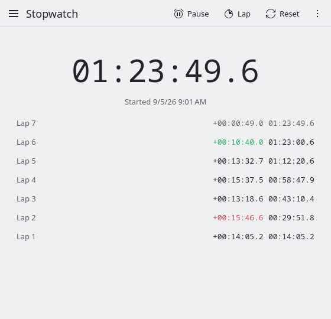

<!--
SPDX-FileCopyrightText: 2026 Aaghash Murugesan <aaghashm@gmail.com>
SPDX-License-Identifier: CC0-1.0
-->

# Persistent Stopwatch

[](https://github.com/aaghashm/persistent-stopwatch/actions/workflows/ci.yml)

A stopwatch for KDE Plasma that never loses time.



## Why this exists

Every stopwatch app I tried has the same flaw: it counts ticks while it is
running, so the moment you close it, the clock stops. Time something that
takes hours or days (a long download, a fermentation, how long a laptop
battery actually lasts, how long you have gone without checking your phone)
and a normal stopwatch is useless the first time the app closes or the
machine reboots.

The fix is old and simple: do not count anything. Store the wall-clock
moment the stopwatch was started, and compute the elapsed time from that
whenever someone asks. Then there is nothing running that can be killed.
Close the app, suspend the laptop, reboot, come back three days later, and
the stopwatch is still exactly right, because it was never really running
in the first place.

This project is also my way of learning to build a proper KDE application:
Qt 6, KDE Frameworks 6, Kirigami for the UI, CMake with extra-cmake-modules,
unit tests, REUSE licensing, the whole thing done the way real KDE apps
like KClock do it.

## Features

- Elapsed time survives application restarts and full system reboots
- Lap times with per-lap splits and running totals; the fastest lap is
  green, the slowest red; copy them all as a table
- Undo an accidental reset (**Ctrl+Z**), laps included
- Keyboard shortcuts: **Space** start/pause · **L** lap · **R** reset
- Shows when the current run was started
- Full command line control, no window needed, works over SSH
- Start/pause, lap and reset from the launcher's right-click menu
- Native Plasma look and feel, including your system fonts and icon theme

## Command line

The window is optional. Everything can be done from a terminal, a script
or a global shortcut:

```
persistent-stopwatch --reset --start   # restart from zero
persistent-stopwatch --lap
persistent-stopwatch --pause --status  # Paused 00:42:17.3 (started ...)
persistent-stopwatch --json            # for scripts and status bars
```

`--toggle` starts or pauses depending on the current state. Bind it to a
global shortcut in System Settings → Keyboard → Shortcuts (the launcher's
"Start or Pause" action) and you can time things without touching the
window at all.

Commands update the saved state directly and never open a window. If the
window is open, it notices and follows along. See `man persistent-stopwatch`.

## Questions

**Does it keep counting while the computer is off?** Yes. It doesn't
count at all; it remembers when you started and subtracts. Whatever the
machine was doing in between, the answer is right when you look again.

**What if the clock changes?** Moving the system clock forward makes the
time jump forward too, since that's indistinguishable from time passing.
Moving it backward never makes the time shrink; it's clamped.

**Can I run it on GNOME or another desktop?** Yes. It needs the KDE
Frameworks libraries (the packages pull them in) but not Plasma. Without
the KDE desktop style installed it uses Qt's default look.

**Where is the data?** `~/.local/state/persistentstopwatchstaterc`, a
small text file. Delete it to start from scratch.

## How the code is laid out

```
src/
  stopwatchengine.{h,cpp}   The heart. A small state machine (Stopped,
                            Running, Paused) that persists timestamps
                            through KConfig and derives elapsed time on
                            demand. Knows nothing about the UI.
  lapsmodel.{h,cpp}         QAbstractListModel holding lap totals. Splits,
                            fastest and slowest are derived from them.
                            Restored data is sanity-checked before use.
  duration.{h,cpp}          The hh:mm:ss.t format used everywhere.
  Main.qml                  The whole UI: one Kirigami page with the time
                            display, actions, and the lap list.
  commandline.{h,cpp}       The --start/--pause/--lap/--reset/--status
                            options, shared by main() and the tests.
  main.cpp                  Startup wiring: KAboutData, single instance,
                            command line, QML engine.
autotests/
  stopwatchenginetest.cpp   Unit tests for the engine. The engine takes an
                            injectable clock, so tests simulate restarts,
                            reboots, and clocks that jump backwards without
                            ever sleeping.
  lapsmodeltest.cpp         Lap marks, ties, and model consistency.
  commandlinetest.cpp       Flag handling and output formats.
icons/                      The app icon (Breeze-style SVG).
doc/                        Man page.
completions/                bash, zsh and fish completions.
LICENSES/                   Full license texts, per the REUSE spec.
```

The two `.desktop` and `.metainfo.xml` files in the root are what desktop
environments and app stores read: the launcher entry and the store listing.

## Where the project stands

Working: the engine with unit tests, the Kirigami UI, persistence across
restarts and reboots, app icon, desktop integration files.

Usable day to day. Next: packages for Debian and Ubuntu, screenshots and
a small website.

## Installing

The quickest way, on Fedora, Debian, Ubuntu or Arch:

```
curl -fsSL https://aaghashm.github.io/persistent-stopwatch/install.sh | sh
```

It only picks the right package and hands it to your package manager
([read it](docs/install.sh)). To do that by hand, packages are attached to
every [release](https://github.com/aaghashm/persistent-stopwatch/releases/latest).

Fedora 44 or newer:

```
sudo dnf install https://github.com/aaghashm/persistent-stopwatch/releases/latest/download/persistent-stopwatch.$(uname -m).rpm
```

Debian 13, Ubuntu 25.04 or newer:

```
arch=$(dpkg --print-architecture)
curl -fLO https://github.com/aaghashm/persistent-stopwatch/releases/latest/download/persistent-stopwatch_$arch.deb
sudo apt install ./persistent-stopwatch_$arch.deb
```

Arch Linux: build it with the PKGBUILD in `packaging/arch`:

```
cd packaging/arch && makepkg -si
```

## Building from source

Dependencies (Fedora):

```
sudo dnf install cmake ninja-build gcc-c++ extra-cmake-modules \
    qt6-qtbase-devel qt6-qtdeclarative-devel \
    kf6-kirigami-devel kf6-kconfig-devel kf6-ki18n-devel kf6-kcoreaddons-devel \
    kf6-kcrash-devel kf6-kdbusaddons-devel kf6-kwindowsystem-devel \
    kf6-qqc2-desktop-style
```

Build, test, and install:

```
cmake -B build -G Ninja
cmake --build build
ctest --test-dir build --output-on-failure
sudo cmake --install build
```

## How persistence works

The engine persists three facts through KConfig's state storage
(`~/.local/state/`): the current state, the milliseconds accumulated before
the last start, and the wall-clock timestamp of the last start. Elapsed time
is always computed from those, never counted. State is written on every user
action, so even a power loss can only lose what happened after the last
button press, which is nothing.

Backward wall-clock jumps (NTP corrections, a dead RTC battery) are clamped so
elapsed time can never go negative or shrink.

## Development

The code follows the KDE Frameworks coding style, enforced by
clang-format (a pre-commit hook is installed when you configure). CI
builds and tests every push on Fedora and Debian, checks REUSE
compliance, the desktop and AppStream files, and builds, installs and
runs the RPM and the .deb.

## License

GPL-2.0-or-later. This repository follows the
[REUSE](https://reuse.software/) specification.
